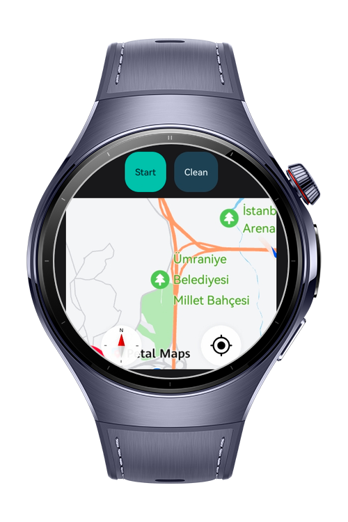
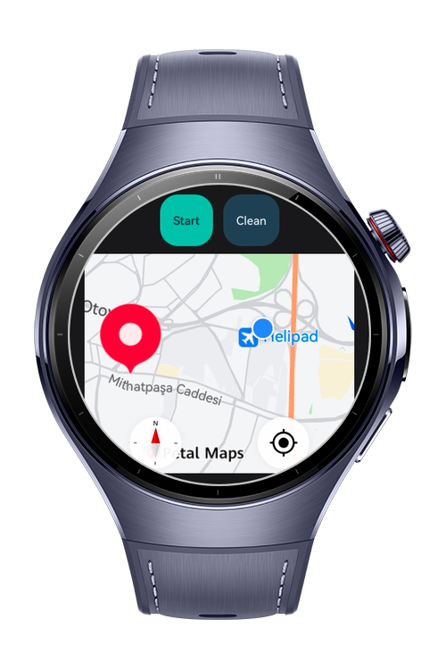
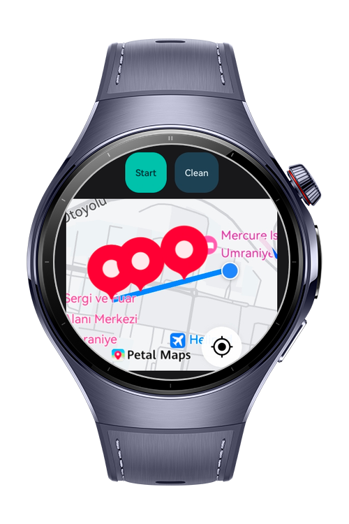

> **Note:** To access all shared projects, get information about environment setup, and view other guides, please visit [Explore-In-HMOS Index](https://github.com/Explore-In-HMOS/hmos-index).

# How to build Route Tracker

This codelab showcases how to build a route tracker on wearable using HarmonyOS NEXT APIs.
It focuses solely on a basic use case, just tapping a marker to define end route location, showing current user location and start/clear route operation by providing poly line on map

# Preview

<div>
    
    
    
    
</div>

# Use Cases

- Show a current location on map
- Tapping marker to define route's end point
- Providing polyline to show route
- Camera zoom in/out options
- Focusing closely by camera when route starts

# Technology

## Stack
- **Languages**: ArkTS
- **Frameworks**: HarmonyOS SDK 5.1.0(18)
- **Tools**: DevEco Studio Version 6.0.1
- **Libraries**:
  - `@kit.AbilityKit`
  - `@kit.BasicServicesKit`
  - `@kit.LocationKit`'
  - `@kit.MapKit`

## Required Permissions
- `ohos.permission.INTERNET`
- `ohos.permission.ACCELEROMETER`
- `ohos.permission.LOCATION`
- `ohos.permission.APPROXIMATELY_LOCATION`

# Directory Structure
```
entry/src/main/ets/
|---data
|   |---MockRoute.ets              // Mock Lat-Lng information
|   |---routeConfig.ets            // Route Configurations
|---pages
|   |---Index.ets                  // Main page to show map and marker
|---module.json5                   // Permissions and meta config
```
# Constraints and Restrictions

## Supported Devices

- Huawei Watch 5
- DevEco Studio Simulator

# License
**How to build a Route Tracker (HarmonyOS NEXT)** is distributed under the terms of the MIT License
See the [license](./LICENSE) for more information.
